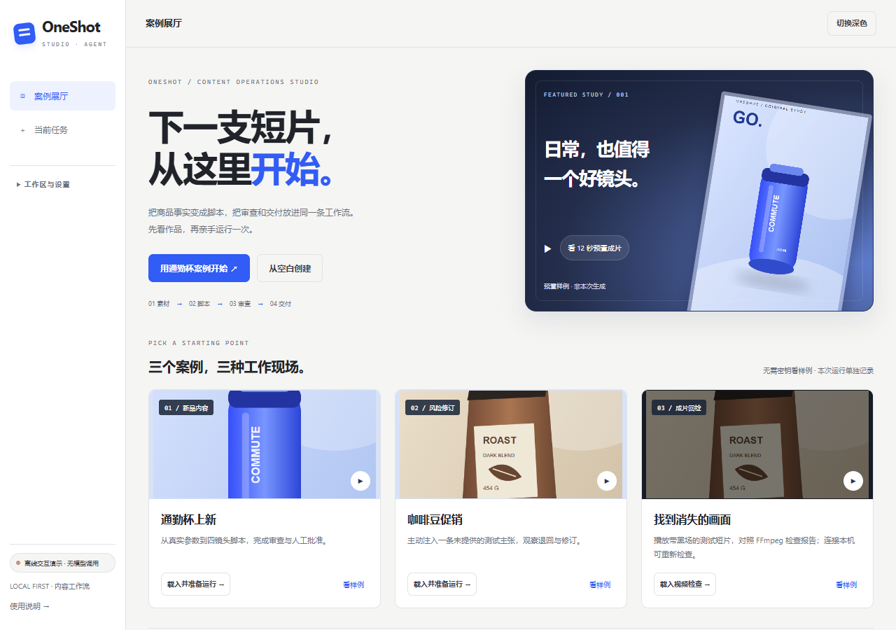

# OneShot Studio · 电商视频运营工作台

[打开案例展厅](https://restartbaiye.github.io/oneshot-studio/?demo=1) · [下载完整 Windows 包](https://restartbaiye.github.io/oneshot-studio/OneShot-Windows.zip)

把商品事实组织成可审阅的四镜头脚本，人工批准后用本机 FFmpeg 制作短片；也可以检查已有视频的黑场等技术问题。**案例先展示输出，工作区单独记录本次实际运行。**

## 30 秒开始

1. 打开在线展厅，点击“看样例”：无需密钥或本机服务，即可播放三段预置 MP4、查看报告。
2. 点击“载入并准备运行”，进入 **素材 → 脚本 → 审查 → 交付**。预置 MP4 不会写入本次任务。
3. 点击“生成并检查脚本”。咖啡案例会故意注入一次未提供的测试主张，展示真实退回与修订；在审批窗口选择批准或拒绝。
4. 批准后，第 4 步可下载本次脚本文案、字幕、分镜和审查报告。连接本机服务后才能制作新的 MP4，或重查已有视频。

| 案例 | 无需安装可看 | 可现场重跑 |
|---|---|---|
| 通勤杯上新 | 12 秒预置短片、制作报告 | 脚本 → 初筛 → 人工批准 → 本机制作 |
| 咖啡豆促销 | 预置短片、两轮检查记录 | 一次故障注入 → 修订 → 重新检查 |
| 找到消失的画面 | 带黑场的测试片、预先测得的黑场报告 | 载入视频 → 本机重新检测 → 下载本次报告 |

预置案例是自制商品示意图与演示规格，不是真实品牌广告；**不是本次生成、不是模型在线验收，也不代替比赛要求的现场运行。**

## 本机完整运行

需要 Node.js 18+、FFmpeg/FFprobe（含 libx264、drawtext）和中文字体。已验证环境为 Windows + Edge + FFmpeg 9.0.2；这些系统依赖不随包分发。

解压整个安装包，双击 `media-service/start.bat`；或在仓库根目录运行：

~~~sh
node media-service/server.cjs
~~~

打开 **http://127.0.0.1:41739/?demo=1**，保持窗口运行，Ctrl+C 停止。不需要先安装 npm 依赖来运行服务。

默认从 PATH 找 ffmpeg/ffprobe，Windows 使用系统微软雅黑。可设置 `FFMPEG_PATH`、`FFPROBE_PATH`、`ONESHOT_FONT` 和 `ONESHOT_PORT`。公共 Pages 访问本机可能被浏览器本地网络权限拦截；这时直接用本机网址，不要放宽跨域或向公网转发端口。

直接双击 index.html 不支持案例 fetch，请通过 HTTP 服务或在线展厅使用。

## 模型与边界

- 无密钥示例明确使用离线规则，不假装调用模型。可以在“工作区与设置 → 模型设置”填写支持浏览器跨域的 OpenAI 兼容 API；Key 仅页面内存，刷新后重填。请求会把商品输入与草稿发送至你配置的提供方。
- 受约束 Agent：固定且校验的工具顺序、预算、最多三轮规则审查、失败停止、工具证据和人工批准。不是通用自主规划、多 Agent 或 MCP 平台。
- MP4 是静态商品图/模板背景加字幕，H.264、1080×1920、24fps，无音轨；不是生成式视频。脚本的 15 秒时序与可选 8–30 秒视频制作时长分开，视频有自己匹配的 SRT。
- 审查是词表、数值、字幕结构和视频技术指标；不保证事实完整、法律合规、平台过审或审美质量。无视觉模型、自动发布、云端编码、账号后台或断点续跑。
- 修改输入会使旧审批和下载失效。审批是网页工作流的人工闸门，不是本机 API 的多用户鉴权。
- 商品图片和视频只传给本机服务；上传原视频及编码临时图会清理，成片与报告保留在 `deliveries/`。草稿和记忆保存在浏览器，清网站数据可清除。

## 源码、测试与复现

本仓库包含网页源码、本机服务、三个样例及原图、样例构建脚本、自动化测试、打包脚本和公开设计/验收文档。无密钥、真实用户上传、私人报名信息、历史临时目录或 node_modules。

~~~sh
npm ci
npm test                 # 11 项运行时回归，不需要媒体服务
npm start                # 单独终端保持运行
npm run test:ui          # 真实 MP4、样例隔离、两主题/六宽度、权限等
npm run test:interaction # 键盘、批处理隔离、动效和加载失败重试
npm run samples:build    # 重新生成三份明确标注的预置案例
python scripts/package.py
~~~

浏览器测试默认使用已安装的 Edge，可通过 BROWSER_PATH 指定兼容 Chromium 可执行文件。TEST_URL 可指定测试服务；MEDIA_ROOT 可指定服务实际写出目录；EVIDENCE_DIR 可指定截图/报告目录。默认测试结果在 test-results/，不入库。构建样例需要同一运行中的本机服务与 FFmpeg；没有付费 API 调用。打包脚本仅额外需要 Python 3 标准库。

- [架构与接口](docs/ARCHITECTURE.md)
- [评分标准逐项证据与差距](docs/RUBRIC.md)
- [验收及已修复问题](docs/ACCEPTANCE.md)
- [四分钟现场演示路径](docs/DEMO.md)
- [样例来源与重建](docs/SAMPLES.md)

公开网页用于试用；现场参赛应使用本机服务，实时运行任务，不把预置短片当成现场结果。
